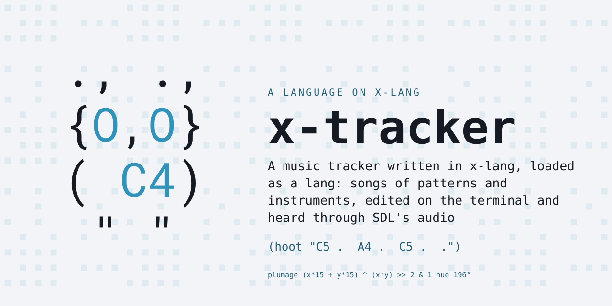

# x-tracker

A music tracker written in [x-lang](https://github.com/jonruttan/x-lang),
loaded as a lang: songs of patterns and instruments, edited on the
terminal and heard through SDL's audio.

    x -l tracker -- [OPTIONS] [edit] [FILE]
    x -l tracker -- [OPTIONS] play FILE
    x -l tracker -- list FILE
    x -l tracker -- [OPTIONS] render FILE -o OUT.wav
    x -l tracker -- [OPTIONS] import FILE -o OUT.xon
    x -l tracker -- help [WORD]

      -s, --song NAME    the song to edit or play (the file's first); the name import gives
      -w, --waves FILE   read the (wave ...) forms of FILE too; again for another
      -l, --loop         play the song over and over, until q
      -o, --output FILE  the WAV file render writes, the song file import adds to
      -r, --rows N       rows a beat import places a MIDI file's notes on (4)
      -u, --tune N       the tune of a SID file import plays (its first)
      -t, --time SECS    seconds of a SID tune import plays (60)
      -n, --no-sound     edit without opening the audio
      -V, --version      print the version and exit
      -h, --help         print the help and exit; after a word, that word's

The songs are the ones x/audio/tracker plays, and x-roguelike's music
is made of: a file is any `.xon` file of `(song ...)` forms, with the
`(wave NAME AMP ...)` forms their instruments name.  `data/demo.xon` is
one to start from:

    x -l tracker -- data/demo.xon

`data/hungarian-dance-5.xon` is a longer one: Brahms's Hungarian Dance
No. 5, its changes of tempo written into the rows.

    x -l tracker -- play data/hungarian-dance-5.xon

`data/undertow.xon` is an original drum and bass tune at 174 bpm: a
two-step breakbeat, a reese over a sub, and a hook that comes back,
echoed, in each drop.

    x -l tracker -- play data/undertow.xon

[docs/guide.md](docs/guide.md) is a guide to using the tracker: a first
track written key by key, then each kind of work the editor does.
[docs/writing.md](docs/writing.md) is a guide to writing songs: the
format, every effect, and how to make music with them.

`play` plays a song once through, or with `--loop` until q, the pattern
heard written to standard error; `list` prints each song of a file with
how long it lasts, its patterns and its order; `render` writes a song
played once through, ringing out, to a WAV file (16-bit stereo, 44100
frames a second).  With no operands
`x -l tracker` is the lang's REPL.

To edit x-roguelike's delve music, whose waves are kept in another file:

    x -l tracker -- -w data/delve/sounds.xon data/delve/music.xon

A file can hold its own waves, so it needs no other: `:waves keep`
copies each wave its songs borrow from a `-w` file into it, as
`(wave NAME AMP ...)` forms before its first song, and `:w` writes
them.  A wave's numbers are the strengths of its harmonics, the
fundamental first: `(wave hollow 6 0 2 0 1)`.

## The editor

The editor is laid out and keyed as Impulse Tracker and Schism Tracker
are.  A pattern fills the screen, a row a line and a channel a column
headed by its instrument and the instrument's number; a cell is four
columns, the note, the instrument, the volume and the effect.  Above
it are the song's tempo, the octave notes are typed in, and the order,
the pattern edited in brackets and the one being heard marked `>`.
Notes are typed on two rows of the keyboard as on a piano's keys:

    z s x d c v g b h n j m ,    C to C, in the octave
    q 2 w 3 e r 5 t 6 y 7 u i    the octave above

and heard as they are typed.  The function keys go to the pages:

    F1 help   F2 pattern   F3 samples   F4 instruments, and envelopes
    F11 order list   F12 song settings   F9 open   F10 ctrl-s write
    F5 play   F6 the pattern   F7 from the row   F8 stop   ctrl-q quit

The pattern's other keys:

    .  or Delete    hold                 - or `  let go    1  cut
    < >             octave down, up      { }  the step: rows moved after a note
    up down PgUp PgDn Home End           move a row, sixteen, to the top, the end
    left right      the cell's columns, then the next channel's
    Alt-left Alt-right  Tab Shift-Tab    a channel left, right
    digits          the instrument column: the channel's instrument;
                    the volume column: the note's gain in percent
    a letter        the effect column: an effect typed after it
    Enter           edit the cell's text: NOTE[:GAIN][/EFFECT...]
    E               edit the channel's instrument
    Insert Shift-Delete                  push the channel's rows down, pull them up
    I D             insert, delete a row in every channel
    4 8             hear the cell, the row
    [ ]             the pattern before, after in the order
    Space           play the song from the pattern edited, or stop
    p               play the pattern edited over and over, or stop
    G               play from the cursor's row: the song, or the pattern
                    when it is not in the order
    L               loop rows: L on the first row, L on the last plays
                    them over and over; Escape forgets the first
    M S             mute, solo the cursor's channel; again to undo it
    H A             mute, solo the channel's instrument
    ; '             tension down, up by 10
    _ +             pace down, up by 10 percent
    9 0             volume down, up by 10 percent
    F               follow the playing, or stop: while it follows, the
                    pattern heard is shown and the cursor is on its row
    O               edit the order in place: left, right pick a place, up,
                    down change its pattern, i copy it, d drop it, [ ] move
                    it, Enter edit its pattern, Escape done
    ( )             move the channel left, right
    U R  ctrl-z     undo, redo
    ?               the help: n p turn the topic, the arrows scroll
    ctrl-c          quit

The blocks, on Impulse Tracker's keys:

    Alt-B Alt-E     mark where the block begins, ends; or Shift and the arrows
    Alt-L Alt-D     mark the channel, then the pattern; a beat's rows, then more
    Alt-U           unmark
    Alt-C Alt-Z     copy, cut
    Alt-P Alt-O Alt-M                    paste pushing the rows down, over, into the holds
    Alt-Q Alt-A     a semitone up, down; with Shift an octave
    Alt-K Alt-X     slide the gains, the first effect, from the first row to the last
    Alt-W Alt-V Alt-J                    clear the gains, set them, take them up or down
    Alt-F Alt-G     stretch to twice the rows, squeeze to half
    V  Y X P        mark from the cursor; copy, cut, paste
    Delete          clear the block marked

F3's samples, on Schism Tracker's keys: Tab walks a sample's settings
(volume, global volume, pan, C-5 speed, loop, sustain loop, vibrato),
left and right change one, and the sound is drawn beneath.

    Alt-G Alt-I Alt-H                    reverse, upside down, centre the sound
    Alt-M           amplify; the loudest it can be is offered
    Alt-B Alt-L     cut before the loop, after it
    Alt-E Alt-F     resize, read between frames, at the nearest
    Alt-Shift-E     resample, its pitch kept
    + -  Alt-+ Alt--                     the C-5 speed a semitone, an octave
    Alt-O  ctrl-z   write the sound to its WAV file; undo an edit of it

`:` takes a command, as vi does:

    :w [FILE]   :q   :q!   :wq       write, quit
    :song [NAME]                      edit or make a song; alone, list
                                      them to pick one with up, down, Enter
    :rename NAME                      rename the song
    :bpm N  :rows N  :ticks N  :tension-bpm N
    :len N                            the pattern's rows
    :pattern NAME                     edit a pattern, made if it is new
    :order NAME ...                   the order the patterns play in
    :channel INSTRUMENT  :drop        add a channel, drop the cursor's
    :instrument NAME PROP ...         make or change an instrument
    :octave N  :step N
    :tension N  :pace N               how the song is heard: 0-100, 10-400
    :volume N                         0-100 percent
    :mute [INSTRUMENT]                mute an instrument; alone, say what
                                      is muted and soloed
    :solo [INSTRUMENT]                solo an instrument
    :unmute                           hear every channel and instrument
    :loop [FROM TO]                   play rows FROM to TO of the pattern
                                      over and over; alone, all of it
    :render FILE                      write the song played once to a WAV
                                      file, as it is heard
    :waves                            list the waves the songs name, and
                                      where each comes from
    :waves keep                       copy the waves borrowed from -w files
                                      into this file
    :wave NAME [AMP ...]              show a wave, or make or change it
    :sample NAME FILE [ROOT] [START END]  keep a WAV file as the wave NAME
    :sound OP [N] [FROM TO]           edit the sound of the sample picked
                                      on F3: reverse invert centre amplify
                                      normalise silence fade-in fade-out cut
                                      crop resize stretch resample; save
    :open FILE                        edit another file
    :amplify PCT                      the block's gains taken up or down
    :effects                          list the effects over the whole mix
    :effect (NAME N ...)              add one: echo reverb phase chorus
                                      drive crush sweep limit
    :effect K  :effect K (NAME N ...)  edit the Kth, or put it in
    :effect drop K                    drop the Kth
    :instruments                      list the instruments, and where each
                                      plays
    :instrument NAME                  edit an instrument's form, or make it
    :copy-instrument NAME NEW  :rename-instrument NAME NEW
    :drop-instrument NAME             one no channel plays
    :channel-instrument NAME          the cursor's channel played by NAME
    :patterns                         list the patterns
    :copy-pattern NEW  :rename-pattern NEW  :drop-pattern [NAME]
    :copy-song NAME  :drop-song
    :transpose N  :gain PCT           the block marked, or the cell:
                                      semitones up or down, a gain set
    :set                              list the settings, the keys among them
    :set NAME VALUE ...               change a setting for this session
    :help [WORD]                      the help's topics, a topic, or every entry named WORD

A change is heard from the next pattern while the song plays; a mute
or a solo from the next row.  A muted channel's heading is dim, a
soloed one's green.  A cell's
effects are x/audio/tracker's (its module notes say what each does):
`a` arpeggio, `v` vibrato, `s` slide, `p` portamento, `t` tremolo, `f`
fade, `l` low-pass, `w` width, `o` cut-off, `x` ring, `y` sync, `c` cut,
`d` delay, `r` retrigger; `C4:60/v20,4`
is C4 at 60 percent with a vibrato.

Written back, a file keeps everything the editor did not change as it
was, comments and layout; a song that was changed is written from the
song, its patterns a row a line with the cells lined up.

## Importing

    x -l tracker -- import tune.mid -o songs.xon
    x -l tracker -- import -u 2 -t 90 tune.sid -o songs.xon

`import` reads a file another program made into a song, and adds it to
the song file `-o` names (made if there is none) after its songs, named
for the file or `-s NAME`; a file with a song of that name already is
refused.  The file is known by its first bytes, not its name.

A MIDI file (`.mid`, a Standard MIDI File of format 0 or 1) is read
note by note.  Its rows are of real time: the song's bpm is the file's
first tempo, `-r N` its rows a beat (4), and each note is put on the row
nearest where it is heard, so a file whose tempo changes keeps its
timing in a song of one tempo.  Each channel and program is an
instrument named for its General MIDI family (`piano`, `organ`,
`strings`, ...), with as many channels as its notes need at once;
channel 10 is drums, an instrument a kind (`kick`, `snare`, `hat`, ...).
A note's velocity is its gain, a channel's first volume and pan its
instrument's, and a note held under the sustain pedal sounds until the
pedal is let go.

A SID file (`.sid`, a C64 tune in PSID or RSID) is a program, so it is
run: a 6502 in x-lang starts the tune (`-u N`, or the one it starts
with) and calls it each frame for as long as the tune is, and each frame the
SID's three voices are taken down: frequency, waveform, pulse width,
envelope, gate and filter.  A row is as many frames as the notes are
apart (where a driver runs a frame late now and then, their time apart
on average), and a tick a frame, so a note started inside a row is
delayed (`/d`).  A note is held through its release and faded (`/f`) to
the level the SID's envelope leaves, then cut (`/c`) where it ends,
which is where a driver writes a quick release or the voice's next note
starts.  A pitch wobbling less than a semitone is a vibrato (`/v`),
one stepping by semitones from frame to frame an arpeggio (`/a`), and
one gliding or moving from row to row a slide (`/s`).  A pulse's width
moves in its cells (`/w`), and so does a filtered voice's cut-off
(`/o`) through the resonant filter, and a note rung or synced by the
voice before it is coupled to that voice's pitch (`/x`, `/y`).  Each
voice and sound (waveform, envelope, the filter's resonance and modes)
is an instrument, `pulse1`, `saw2` and so on, its width and cut-off its
notes' means.  Only the CPU and the SID
are there, no screen and no ROM, so a tune that waits on the screen may
not play.

A tune's length is the one the High Voltage SID Collection gives it in
`DOCUMENTS/Songlengths.md5`, found by the file's MD5: in a directory
above the file, as for one in HVSC's `C64Music`, or under
`$HVSC_BASE`, the `C64Music` directory.  `-t SECS` plays it that long
instead, and a tune HVSC has no length for plays 60 seconds.  The import
says on stderr how far it has played and how far each voice is.

    HVSC_BASE=~/C64Music x -l tracker -- import tune.sid -o songs.xon

Both cut the song into patterns, each written once and named again in
the order where it comes back; a note held over a pattern's end is
struck again at the next.

## Help

The help is one set of tables (tracker/help.x), shown three ways: `?`
in the editor pages through its topics, `:help` lists them, and
`x -l tracker -- help` prints them.  The topics are keys, commands,
cells, effects, song, instruments, waves, order, settings and cli.

    :help effects          a topic
    :help loop             every entry named loop: here the :loop command
    :help /v  :help :mute  an effect by its slash, a command by its colon
    x -l tracker -- help gain     the same, printed
    x -l tracker -- render -h     the help on a word of the command line

The suite checks that every command the editor takes, every action a
key can be bound to and every setting has an entry.

## Settings

The settings are read from `$X_TRACKER_CONFIG`, else
`$XDG_CONFIG_HOME/x/tracker.xon`, else `~/.config/x/tracker.xon`, as
x's own theme and syntax files are found; an empty `X_TRACKER_CONFIG`
reads none.  The file is data, read and never run: each form is a
setting, and `:set` in the editor takes the same form without its
parentheses, for the session.  `:set` alone lists every setting with
its value.

    ; ~/.config/x/tracker.xon
    (octave 3)                 ; the octave notes are typed in, 0-8 (4)
    (step 1)                   ; rows the cursor moves after a note, 0-64 (1)
    (follow on)                ; follow the playing (on)
    (backup on)                ; :w first copies the file to FILE.bak, once a session (on)
    (undo 200)                 ; changes kept to undo, 1-10000 (200)
    (sound on)                 ; off edits without the audio, as -n does (on)
    (waves "sounds.xon")       ; wave files read as -w reads them, from this file's directory
    (colour beat (bold) yellow ())
    (key undo "u")
    (key play enter)

A switch is `on` or `off` (`yes`, `no`, `#t`, `#f`).  `sound` and
`waves` are read as the editor starts, so `:set` does not change them.

`(colour NAME ATTRIBUTES FOREGROUND BACKGROUND)` is the style the editor
draws NAME in, as x/tui/style's `Style make` takes it: the attributes a
list of `bold dim italic underline reverse strike`, a colour 0 to 255,
`black red green yellow blue magenta cyan white`, `bright-` any of
those, or `()` for the terminal's own.  The names and their defaults:

    title    (reverse) () ()    the line at the top
    empty    (dim) () ()        an empty cell, a row off the beat, the hint line
    heading  (bold) () ()       a channel's instrument, a heading
    beat     () 3 ()            a row on the beat
    off      () 1 ()            a let-go cell
    effect   () 6 ()            the effect column
    instrument () 5 ()          the instrument column
    volume   () 2 ()            the volume column
    cursor   (reverse) () ()    the cursor, a song picked
    playing  (bold) 2 ()        the row heard
    block    () 0 6             the cells of the block marked

`(key ACTION KEY ...)` binds an action to other keys: each a character
in a string, `"u"`, or a key's name, as `enter up down left right
page-up page-down home end complete interrupt`.  A bound action's own key
no longer does it; `(key ACTION)` gives it back.  The actions, and their
own keys:

    command :        help ?          undo U          redo R
    play Space       play-pattern p  follow F
    previous [       next ]          octave-down <   octave-up >
    step-down {      step-up }       up down left right page-up page-down
    top Home         bottom End      next-channel Tab
    edit-cell Enter  edit-instrument E
    insert-row I     delete-row D    hold .          let-go -
    quit ctrl-c      order O         channel-left (  channel-right )
    mark V           copy Y          cut X           paste P
    play-here G      loop L
    mute-channel M   solo-channel S  mute-instrument H  solo-instrument A
    tension-down ;   tension-up '    pace-down _     pace-up +
    volume-down 9    volume-up 0

A form that is not a setting is one line on standard error, and the
first is shown in the editor; the rest of the file is still read.  A
file that does not read is one line, and the defaults.

## Install

    make install X=/path/to/x

copies the bundle to `<share>/bundles/tracker`, where `x -l` looks.  The
sound needs SDL3: without it the editor runs silent and says so.

## Tests

    make test     # the spec suite
    make check    # the suite against tests/contract/known-failures.txt

## Licence

MIT No Attribution (MIT-0); see LICENSE.
